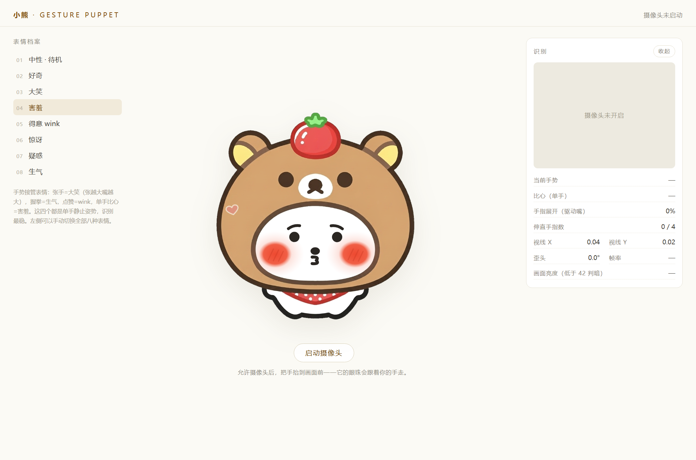

# 手势玩偶 · Gesture Puppet

打开摄像头，用手势操纵一只卡通角色的表情和动作。识别全在浏览器本地跑，画面不上传。



## 四个手势

| 手势 | 反应 |
|---|---|
| 张开手掌 | 大笑，手张得越大嘴张得越大 |
| 握拳 | 生气，头顶闪怒气符号 |
| 竖大拇指 | 眨一只眼，锁定 3 秒 |
| 拇指食指捻一下（单手比心） | 害羞，脸两侧飘小爱心 |

另外：手离开画面 1.5 秒会提示「把手抬进画面」，画面太暗会提示并露出疑惑表情。左侧表情档案可以手动点任意表情，不摆姿势也能看。

## 怎么跑

页面要用 `http://127.0.0.1` 打开，双击 `index.html` 不行 —— 摄像头授权和本地模型加载都需要一个 HTTP 服务。

**Windows**：双击 `启动小熊网站.bat`，浏览器会自动打开 http://127.0.0.1:8777/index.html

**其他系统**：

```bash
python tools/serve.py 8777
```

然后访问 http://127.0.0.1:8777/index.html ，第一次会弹摄像头授权，点允许。

`tools/serve.py` 比 `python -m http.server` 多一个写盘接口，供校准页保存五官坐标用。只想看页面的话两者都行。

## 文件结构

```
index.html          主页面
app.js              摄像头 → 关键点 → 手势 → 表情，状态机与插值
gestures.js         手部关键点分类（张手 / 握拳 / 点赞 / 比心）
character.js        参数化 SVG 表情渲染器，8 个预设
face.json           当前角色的五官坐标（换角色只换这个 + 底图）
calibrate.html      五官校准页，拖 6 个点对位后保存
assets/
  character-base.png  透明底、空脸的角色底图
  hand_landmarker.task MediaPipe 手部关键点模型（7.8MB）
vendor/             MediaPipe Tasks Vision 本地包与 wasm
tools/
  serve.py            带写盘的本地服务
  prep_face.py        抠背景、擦原图五官、生成 face.json
  test-gestures.mjs   手势分类器测试（node 跑）
  sim.html            状态机测试，用合成关键点跑，不开摄像头
  fx-test.html        粒子切换测试
猫耳拳手/            第二个角色，同一套代码换 face.json 与底图
PRD.html            需求文档
user-stories.md     用户故事
```

## 换一个角色

`face.json` 把五官位置从代码里拆了出来：`canvas` 是画布尺寸，`eyeL/eyeR/nose/mouth/blushL/blushR/brow/pivot` 是各部位坐标与尺寸，`ink` 是描边色。

换角色的流程：

```bash
python tools/prep_face.py --src 你的图.png --marks 五官位置.json --out 目标目录
```

`--marks` 是一份归一化坐标（0~1，相对原图宽高），给眼睛、鼻子、嘴、腮红的大致位置。脚本会抠掉外部背景、按坐标擦除原图五官、把坐标换算到裁切后的画布，再往附近的深色块上吸附一次。跑完输出 `character-base.png` 和 `face.json`。

自动定位一定有偏差，接着打开 `calibrate.html` 拖点微调，右侧实时预览，满意后点保存写回 `face.json`。

`猫耳拳手/` 就是这样生成出来的：同一份 `app.js`、`gestures.js`，只有 `face.json` 和底图不同。

## 技术要点

- **识别**：MediaPipe Tasks Vision HandLandmarker，21 个关键点，本地 wasm + 本地模型文件，GPU 失败自动回落 CPU。
- **判据**：纯几何规则。手指伸直 = 指尖到手腕距离 > 第二关节到手腕距离 × 1.12；握拳允许一根没蜷实，但那根不能超过 1.30；竖大拇指额外要求指尖高于根关节。没有训练，改阈值就是改一行常数。
- **表情**：SVG 逐层拼装，`#pose`／`#gaze`／`#mouth` 三个锚点每帧改 transform，不重建 DOM。嘴的张开度直接由手掌张开度驱动。
- **稳定性**：每帧数据都在抖，所以不直接赋值。视线用 K=0.15 的弹簧靠近，歪头 K=0.06 并带 1.8° 死区；张手进入 0.72、退出 0.45 做滞回；手势去抖 180ms。少了这些，脸会抽搐。
- **旋转轴**：定在脖子处 (435, 790) 而不是画布中心，否则歪头时整个身子跟着摆。

## 已知限制

- 只支持单手静态手势。挥手、双手比心、手快速凑近这类需要时间窗口或依赖相机行为的动作已移除，识别稳定性优先。
- 只认卡通/插画角色：正面、五官完整、纯色或透明背景。真人照片的肤色有渐变，擦除后会留色块。
- 摄像头在非 HTTPS 页面会被浏览器禁用，本地必须走 localhost，或者部署到 HTTPS。
- 只在桌面 Chrome / Edge 上验证过，手机端没做专门适配。

## 测试

```bash
node tools/test-gestures.mjs
```

吐出一份分类器逐项结果。状态机和粒子切换用浏览器打开 `tools/sim.html`、`tools/fx-test.html`，它们用合成关键点驱动页面，不需要摄像头。
